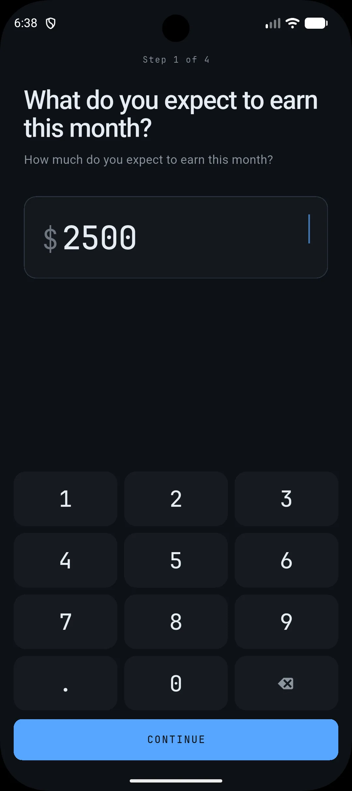

# Planning Your Income: The First Step to a Calmer Budget

Understanding how much money you expect to receive is fundamental to creating a realistic and effective monthly budget. Without this foundational step, it's challenging to allocate funds for expenses, savings, or debt repayment. Budget Plan helps you define this crucial figure clearly and simply.

## Why Setting Your Expected Income Matters

The screen you see here is the starting point for building a budget that works for you. It asks, "What do you expect to earn this month?" This isn't about guessing; it's about setting a target based on your known income sources.

For many, this might be a steady salary from employment. For others, it could be a combination of freelance payments, benefits, or other regular income. By inputting this amount, you establish the total financial resources available for the month. This figure then becomes the ceiling for your planned spending and saving. It transforms abstract financial goals into tangible numbers that guide your decisions.

## How to Plan Your Income

This initial step is straightforward. You'll see a prompt to enter the amount you anticipate earning. Use the on-screen numeric keypad to input your total expected income for the month. For example, if you expect to receive €2,500, you would enter that figure.

Consider all your reliable income streams. If you have variable income, aim for a conservative estimate based on your average earnings or your lowest expected income. It's always better to budget with a slightly lower income and have a surplus than to overestimate and fall short. This approach helps prevent overspending and keeps your budget grounded in reality.

## Moving Forward with Your Budget

Once you've entered your expected income, you'll proceed to the next steps in setting up your monthly plan. This includes categorizing your expenses and allocating funds accordingly. Having your income clearly defined makes these subsequent steps more focused and manageable. It allows you to see precisely how much is available for your rent, groceries, transit, savings, or any other category you define.

For instance, if your expected income is €2,500, and you've budgeted €800 for rent, €400 for groceries, and €200 for savings, you can immediately see how much is left for other expenses. This clarity prevents the common feeling of money disappearing without a trace.

**Your Action Today:** Open Budget Plan and enter your expected income for the current month. If you're unsure of an exact figure, use your best estimate based on past earnings or your most recent pay stubs. This simple act is the first, vital step towards a more organised and calmer financial life.
