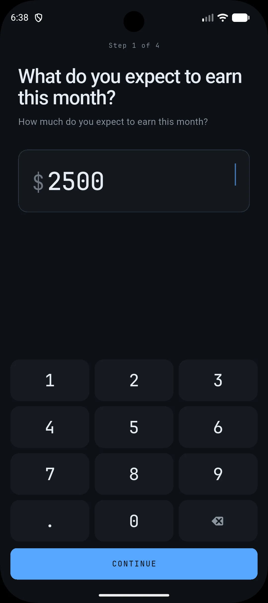

# Plan Your Monthly Income

Understanding your expected income is the crucial first step in creating a realistic and effective monthly budget. Without a clear picture of what's coming in, it's difficult to plan what needs to go out. Budget Plan helps you establish this foundation by prompting you to enter your anticipated earnings for the month ahead.

This screen, "What do you expect to earn this month?", is designed to be straightforward. It asks for the total amount you anticipate receiving before any deductions. This figure serves as the top line of your budget, guiding all subsequent planning for your expenses.

## Why Income Planning Matters

Your income is the engine that powers your financial life. Knowing your expected income allows you to set realistic spending limits for all your categories, from essential groceries and rent to discretionary dining out and savings goals.

For example, if you expect to earn €2,500 this month, this number becomes your ceiling. You can then confidently allocate funds to cover your rent, utilities, and food, knowing that your income is sufficient. If your expected income is lower, it signals the need to adjust your spending plans accordingly, perhaps by reducing non-essential purchases or looking for ways to save more on everyday items like transit or subscriptions. This proactive approach prevents overspending and the stress that comes with it.

## How to Use This Screen

When you see this prompt, take a moment to consider your typical monthly earnings. This might be your regular salary, or it could be an average of freelance income if your earnings fluctuate. Enter the amount you are most confident about receiving.

The interface provides a simple numeric keypad for easy input. Once you've entered your expected income, tap the "CONTINUE" button to move to the next step in setting up your budget. This initial input is foundational, and Budget Plan will use it to help you build a balanced budget that aligns with your financial reality.

## Your Next Step

Today, open Budget Plan and navigate to the income planning screen. Enter your best estimate of your expected income for the current month. This simple action will set you on a clear path to managing your money with greater confidence and calm.
